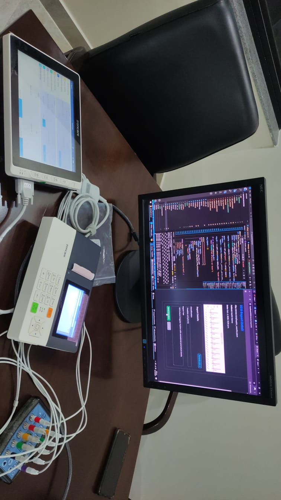
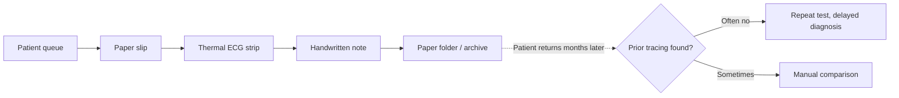
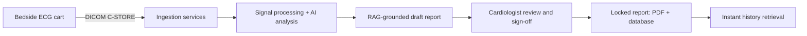
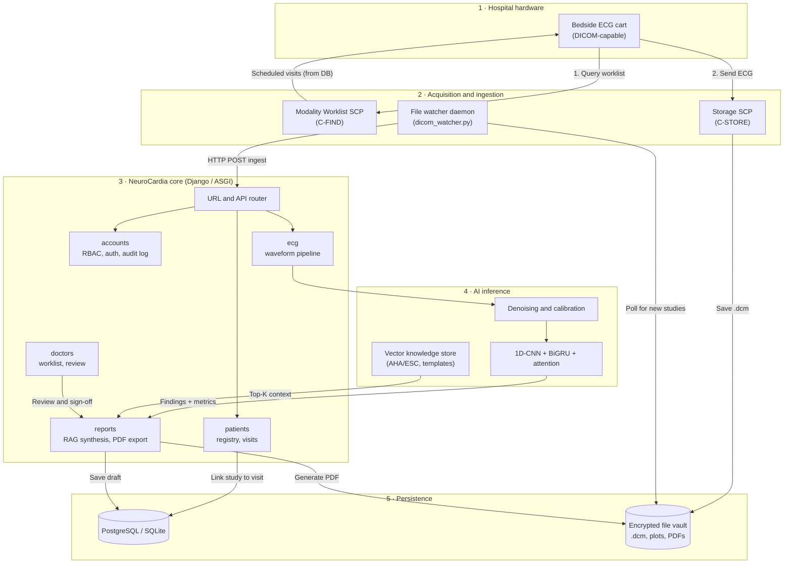
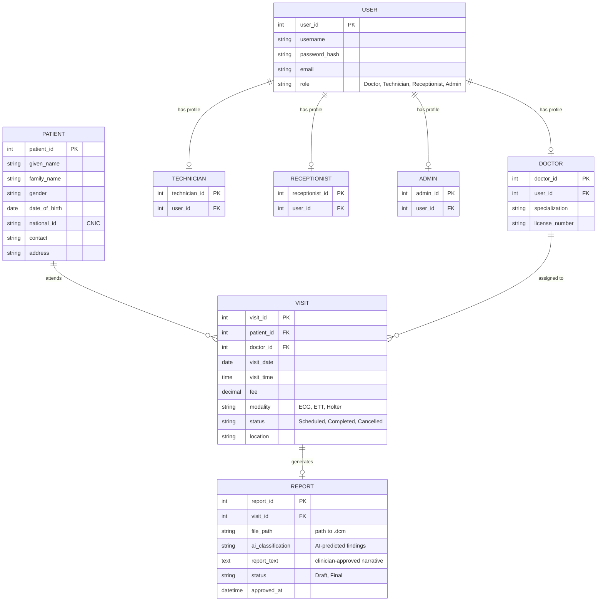
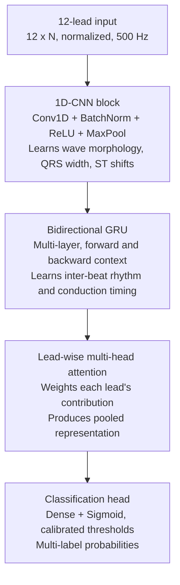
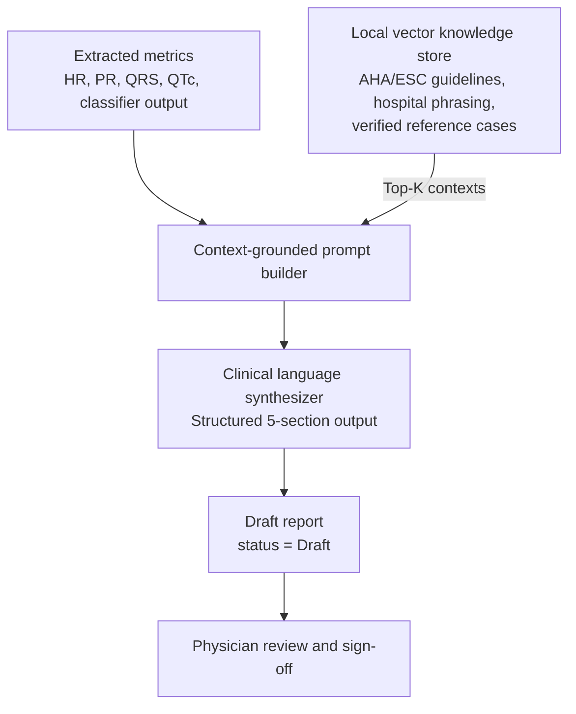
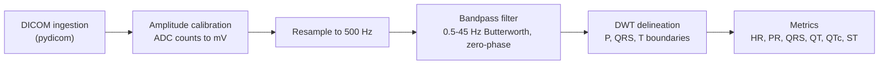
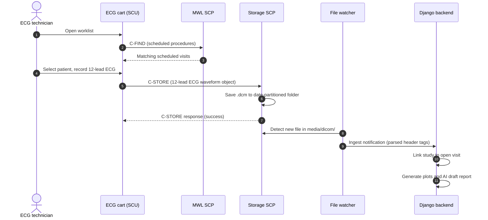

<div align="center">

# 🫀 NeuroCardia

### AI-Assisted Cardiology Information System (CIS)

**DICOM-native ECG acquisition · Deep-learning rhythm classification · RAG-grounded report drafting · Physician-in-the-loop sign-off**



<br/>

[](https://www.python.org/)
[](https://www.djangoproject.com/)
[](https://www.dicomstandard.org/)
[-008080?style=for-the-badge)](https://channels.readthedocs.io/)
[](https://sdgs.un.org/goals/goal3)
[](#-14-project-status--limitations)
[](LICENSE)

</div>

---

## 📑 Table of Contents

1. [The Problem](#-1-the-problem)
2. [The Solution](#-2-the-solution)
3. [Technology Stack](#-3-technology-stack)
4. [System Architecture](#-4-system-architecture)
5. [Database Design](#-5-database-design)
6. [Deep Learning Model](#-6-deep-learning-model)
7. [RAG Report Generator](#-7-rag-report-generator)
8. [Signal Processing Pipeline](#-8-signal-processing-pipeline)
9. [DICOM Networking Flow](#-9-dicom-networking-flow)
10. [Installation & Quickstart](#-10-installation--quickstart)
11. [Role-Based Access Control](#-11-role-based-access-control)
12. [Security & Privacy](#-12-security--privacy)
13. [Roadmap](#-13-roadmap)
14. [Project Status & Limitations](#-14-project-status--limitations)
15. [License & Author](#-15-license--author)

---

## 📌 1. The Problem

In high-volume public hospitals and cardiology centers in developing regions such as Pakistan, ECG management often remains manual and paper-based.



| Pain point | Impact |
| :--- | :--- |
| **Fragile paper traces** | Thermal strips fade, tear, or get misplaced. |
| **Lost longitudinal context** | In OPDs seeing 150–200+ patients a day, finding a prior tracing is impractical, which leads to redundant tests and higher costs. |
| **Inconsistent free-text reports** | Hurried, handwritten notes vary in vocabulary and structure, increasing ambiguity and error risk. |
| **No urgency triage** | Routine scans share one queue with critical cases (ACS/STEMI). |
| **Repeated data entry** | Technicians retype demographics at the cart, causing typos, mislabeled records, and duplicate IDs. |

---

## 💡 2. The Solution

**NeuroCardia** replaces the paper workflow with a browser-accessible, closed-loop Cardiology Information System designed for hospital networks.



- **Zero-retype connectivity**: Works with DICOM-capable ECG carts (e.g., GE, Schiller, Edan, Mindray) over LAN/Wi-Fi using Modality Worklist (`C-FIND`) and `C-STORE`.
- **Automated pre-reading**: Cleans waveforms, delineates wave boundaries, measures intervals (PR, QRS, QT, QTc), and flags arrhythmias, conduction blocks, and STEMI territory.
- **Grounded report drafting**: Retrieval-Augmented Generation (RAG) over clinical guidelines (AHA/ACC/ESC) and local report templates produces structured drafts and reduces hallucination risk.
- **Physician-in-the-loop**: AI output is advisory. Every report stays in `Draft` until an authorized cardiologist reviews, edits, and signs it.
- **Longitudinal retrieval**: Waveforms and verified reports are linked to the patient master record for fast side-by-side comparison.
- **On-premise first**: Designed to run inside the hospital network. Local LLM inference is the default; any cloud LLM is strictly opt-in.

---

## 🛠️ 3. Technology Stack

| Layer | Technology | Responsibility |
| :--- | :--- | :--- |
| **Backend** | Django 5.0+, Python 3.10+ | Web framework, ORM, RBAC, sessions |
| **Real-time** | Django Channels (ASGI / WebSockets) | Live notifications and clinical assistant chat |
| **Medical standards** | `pydicom`, `pynetdicom` | DICOM parsing, C-STORE SCP, Modality Worklist SCP |
| **Signal processing** | `neurokit2`, `scipy`, `numpy`, `matplotlib` | Filtering, baseline removal, R-peak detection, delineation |
| **Deep learning** | PyTorch / TensorFlow | 1D-CNN + BiGRU + attention classifier |
| **Generative AI / RAG** | Local LLM (default), Google Generative AI (optional) | Vector retrieval and structured report drafting |
| **Database** | PostgreSQL (production), SQLite3 (development) | ACID-compliant clinical records and visits |
| **Documents** | `Pillow`, `pdf2image`, `python-barcode` | 12-lead rendering and PDF report generation |
| **Frontend** | HTML5, CSS3, Bootstrap 5, FontAwesome | Responsive UI for clinical staff |

---

## 🏗️ 4. System Architecture

NeuroCardia uses a layered architecture with background services for DICOM ingestion.



---

## 🗄️ 5. Database Design

Relational metadata is stored in the database, while large binary files (`.dcm`, plots, PDFs) live in the file vault and are referenced by path.



**Data dictionary highlights**

- **`User` and profiles**: A custom `AbstractUser` with a `role` field separates clinical rights (signing reports) from administrative rights (scheduling, intake).
- **`Patient` and `Visit`**: Anchor every diagnostic encounter. Duplicate registration is prevented by multi-field validation (name + date of birth + national ID).
- **`Report`**: Links the raw waveform reference to metrics, AI findings, and physician edits. Once `status = Final`, the report is locked and cannot be modified.

---

## 🧠 6. Deep Learning Model

The classifier follows a hybrid CNN–RNN–attention design informed by published ECG-classification literature (Xu et al., Singh et al.).



**Explainability.** The attention weights give a per-lead indication of which leads contributed most to a prediction (for example, II, III, and aVF for an inferior STEMI). This is a review aid for clinicians, not a causal explanation.

**Diagnostic scope**

| Category | Labels |
| :--- | :--- |
| **Rhythm** | Normal sinus rhythm, sinus tachycardia, sinus bradycardia, atrial fibrillation |
| **Conduction** | First-degree AV block (PR > 200 ms), LBBB, RBBB |
| **Ischemia / infarction** | STEMI localization: anterior, inferior, lateral |

---

## 📄 7. RAG Report Generator

Free-form text generation by a general-purpose LLM can hallucinate, which is unacceptable in cardiology. NeuroCardia constrains generation by retrieving relevant guidelines and templates and grounding the prompt in measured values.



**Standardized five-section structure**

1. **Rhythm analysis**: Underlying mechanism, rate, and regularity.
2. **Conduction intervals and axis**: PR, QRS, QT/QTc, and electrical axis.
3. **Chamber morphology**: Voltage criteria for LVH/RVH and atrial enlargement.
4. **Ischemia and infarction**: Lead-grouped ST-T changes, reciprocal depression, pathological Q waves.
5. **Clinical impression**: Summary categorized as routine, abnormal, or critical.

---

## ⚡ 8. Signal Processing Pipeline

Raw waveforms pass through a deterministic DSP sequence before reaching the AI or visualization components.



| Stage | Details |
| :--- | :--- |
| **Ingestion and calibration** | Parse DICOM waveform sequences; convert ADC counts to millivolts using each channel's sensitivity and baseline tags. |
| **Resampling** | Interpolate every lead to a uniform **500 Hz**, so recordings from different machine brands are consistent. |
| **Filtering** | **0.5–45 Hz** zero-phase Butterworth bandpass removes respiratory baseline wander and high-frequency EMG noise. |
| **Delineation** | Discrete Wavelet Transform locates R-peaks and the onset/peak/offset of P, QRS, and T waves. |
| **Metrics** | HR, RR variability, PR, QRS duration, QT/QTc, and ST elevation/depression. |

QTc is computed with Bazett's formula, with `RR` in seconds:

$$
QTc = \frac{QT}{\sqrt{RR}}
$$

---

## 📡 9. DICOM Networking Flow

A dedicated asynchronous DICOM layer connects hospital hardware to the application.



- **Modality Worklist (MWL)**: A DICOM SCP answering `C-FIND` requests. The technician selects the scheduled patient on the cart itself, which removes manual entry.
- **Storage SCP (C-STORE)**: Accepts 12-lead ECG waveform objects (SOP Class UID `1.2.840.10008.5.1.4.1.1.9.1.1`, *12-lead ECG Waveform Storage*).
- **Watcher daemon (`dicom_watcher.py`)**: Runs continuously. When a file lands in `media/dicom/`, it parses header tags, links the study to the patient's open visit, and triggers plot generation and AI drafting.

> **Note:** DICOM's default port, `104`, is privileged on Linux/macOS. Use a non-privileged port such as `11112` in development, and configure the cart's AE title, host, and port to match.

---

## 🚀 10. Installation & Quickstart

### Prerequisites

| Requirement | Notes |
| :--- | :--- |
| **Python** | 3.10 or higher |
| **Git** | Available on `PATH` |
| **Poppler** | Required for PDF rendering. Windows: download the binaries and add `bin/` to `PATH`. Ubuntu/Debian: `sudo apt-get install poppler-utils`. macOS: `brew install poppler`. |

### Setup

```bash
# 1. Clone the repository
git clone https://github.com/RanaHashir0/NeuroCardia.git
cd NeuroCardia

# 2. Create and activate a virtual environment
python -m venv venv
source venv/bin/activate          # Linux / macOS
# .\venv\Scripts\Activate.ps1     # Windows (PowerShell)

# 3. Install dependencies
pip install -r requirements.txt

# 4. Initialize the database and create an admin account
python manage.py makemigrations
python manage.py migrate
python manage.py createsuperuser
```

### Running the services

NeuroCardia needs four processes running together: the web app, the MWL server, the C-STORE receiver, and the file watcher.

**Option A: Windows all-in-one launcher (recommended)**

```cmd
run_all.bat
```

This opens four terminal windows:

1. Django web application (`0.0.0.0:8000`)
2. DICOM Modality Worklist (MWL) server
3. DICOM C-STORE storage receiver
4. DICOM file watcher daemon

**Option B: Manual (any OS)**

Run each command in its own terminal. Adjust the script names to match your repository layout.

```bash
# Terminal 1: Web application
python manage.py runserver 0.0.0.0:8000

# Terminal 2: Modality Worklist server
python dicom/scripts/mwl_server.py

# Terminal 3: C-STORE storage receiver
python dicom/scripts/store_scp.py

# Terminal 4: File watcher daemon
python dicom/scripts/dicom_watcher.py
```

Open the web portal at **http://localhost:8000/**.

---

## 👥 11. Role-Based Access Control

| Role | Permissions |
| :--- | :--- |
| **Receptionist / Admin** | Register patients, book visits and procedures, verify payments, update demographics, manage hospital accounts. |
| **ECG Technician** | Query the Modality Worklist, verify cart–patient pairing, confirm waveform quality, trigger the AI analysis pipeline. |
| **Doctor / Cardiologist** | View the clinical worklist, inspect calibrated 12-lead waveforms, review and edit AI drafts, sign and lock final PDF reports. |

---

## 🔐 12. Security & Privacy

- **Network isolation**: Intended to run on the hospital LAN. No external cloud service is required when using the local LLM.
- **Optional cloud LLM**: If Google Generative AI is enabled, de-identify inputs first and obtain institutional approval. This mode is off by default.
- **Access control**: Role-based permissions enforced server-side; report signing is restricted to authorized clinicians.
- **Auditability**: Authentication events and report state changes are recorded in an audit log.
- **Data at rest**: Studies, plots, and PDFs are stored in a restricted file vault. Enable disk or volume encryption in production.
- **Immutability**: Reports with `status = Final` are locked against modification.

---

## 🗺️ 13. Roadmap

- [x] DICOM Modality Worklist and C-STORE integration
- [x] Signal preprocessing and interval extraction
- [x] Patient, visit, and report management with RBAC
- [ ] Model training, validation, and benchmarking on public ECG datasets
- [ ] RAG knowledge-base expansion and evaluation
- [ ] Side-by-side historical ECG comparison view
- [ ] Urgency-based worklist triage (STEMI-first ordering)
- [ ] Prospective validation with cardiologists

---

## ⚠️ 14. Project Status & Limitations

> **NeuroCardia is an academic final-year project and research prototype. It is not a certified medical device and must not be used for real clinical decision-making without independent validation and the required regulatory approval.**

- AI predictions are assistive only; a qualified cardiologist must review every report.
- Model performance metrics (sensitivity, specificity, F1, calibration) will be published once validation is complete.
- Compatibility with specific ECG cart models depends on each vendor's DICOM conformance statement.

---

## 📄 15. License & Author

Distributed under the **MIT License**. See [`LICENSE`](LICENSE) for details.

**Author:** [Rana Hashir](https://github.com/RanaHashir0)